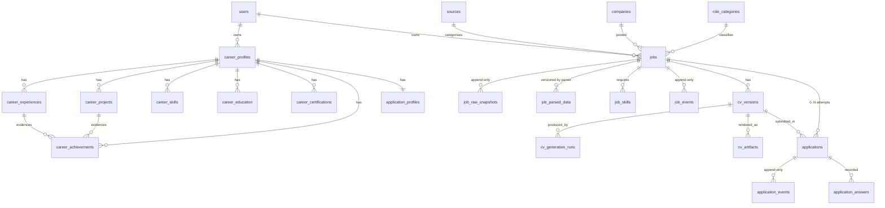

# 04 — Data Model

Milestone 0 ships an **empty baseline migration** (no tables). This document is the design that Milestones 2–4 implement. Entity names here are canonical and must match [05_API_DESIGN](05_API_DESIGN.md), [10_ANALYTICS_DEFINITIONS](10_ANALYTICS_DEFINITIONS.md), and the code.

---

## 1. Conventions

| Concern | Decision | Why |
|---|---|---|
| Primary keys | `bigint generated always as identity` | Simple, compact, readable in URLs; no distributed-ID need at single-user scale |
| Human-facing job ref | `jobs.ref` = `'J' || lpad(seq, 3, '0')` → `J001` | Enables the CV naming the spec asks for: `CV_J001_v2` |
| Timestamps | `timestamptz`, always stored UTC, named `*_at` | Analytics windows must be unambiguous |
| Row lifecycle | `created_at`, `updated_at` on mutable tables; **event tables have only `occurred_at`** | Event rows are never updated |
| Tag lists | `text[]` + GIN index | Small corpus, no taxonomy table needed in V1; upgrade to a join table if a real taxonomy lands (P1) |
| Semi-structured payloads | `jsonb` | Parser confidence maps, CV sections, event metadata |
| Enums | Postgres `enum` types | Bad values become DB errors, not silent data drift |
| Deletes | Soft-delete only where the user can "remove" something; **never** on `*_events` or `job_raw_snapshots` | FR-003, FR-009 |

## 2. ERD



## 3. Career Domain (the fact store)

`career_achievements` is the most important table in the system: it is the atomic unit that CV grounding cites. Every bullet in every generated CV must trace back to a row here (or to an experience/skill row) — see [07_CV_GROUNDING_AND_EVALS](07_CV_GROUNDING_AND_EVALS.md).

```sql
create table career_achievements (
  id                  bigint primary key generated always as identity,
  profile_id          bigint not null references career_profiles(id) on delete cascade,
  experience_id       bigint references career_experiences(id) on delete cascade,
  project_id          bigint references career_projects(id) on delete cascade,
  statement           text   not null,          -- the claim, in the user's own words
  context             text,                     -- scope/situation, not shown verbatim on CVs
  metric_value        text,                      -- e.g. "reduced latency 320ms→90ms"
  metric_verified     boolean not null default false,
  skill_tags          text[] not null default '{}',
  domain_tags         text[] not null default '{}',
  technology_tags     text[] not null default '{}',
  verification_status text   not null default 'unverified',  -- unverified | verified
  notes               text,
  created_at          timestamptz not null default now(),
  updated_at          timestamptz not null default now(),

  -- an achievement belongs to exactly one of experience/project (or neither: profile-level)
  constraint achievement_single_parent
    check (num_nonnulls(experience_id, project_id) <= 1),
  -- a metric may only be marked verified if a metric actually exists
  constraint metric_verified_requires_value
    check (not metric_verified or metric_value is not null)
);

create index on career_achievements (profile_id);
create index on career_achievements using gin (skill_tags);
create index on career_achievements using gin (technology_tags);
```

`metric_verified` exists because the generator's numeric rule depends on it: **an unverified metric may never appear as a number in a CV.** Enforcing that as data (not prompt wording) is what makes G3 testable.

Other career tables (`career_experiences`, `career_projects`, `career_skills`, `career_education`, `career_certifications`, `application_profiles`) are straightforward CRUD entities; fields are listed in [01_PRD](01_PRD.md) FR-005 and the master spec §10/§13.

## 4. Jobs Domain

```sql
create type capture_completeness as enum ('CAPTURED_PARTIAL','CAPTURED_COMPLETE','NEEDS_ENRICHMENT');
create type capture_method       as enum ('extension','manual_url','paste_text','mobile_share');
create type job_status           as enum (
  'SAVED','READY_TO_APPLY','APPLYING','APPLIED','ASSESSMENT','INTERVIEW',
  'FINAL_INTERVIEW','OFFER','REJECTED','WITHDRAWN','SKIPPED');

create table jobs (
  id                    bigint primary key generated always as identity,
  ref                   text   not null unique,          -- 'J001'
  user_id               bigint not null references users(id),
  source_id             bigint references sources(id),
  company_id            bigint references companies(id),
  role_category_id      bigint references role_categories(id),
  url                   text   not null,
  canonical_url         text,                             -- normalised: no tracking params
  title                 text,
  capture_completeness  capture_completeness not null,
  current_status        job_status not null default 'SAVED',
  dedupe_key            text,                             -- see §7
  duplicate_of_job_id   bigint references jobs(id),
  idempotency_key       text,                             -- see §8
  created_at            timestamptz not null default now(),
  updated_at            timestamptz not null default now()
);

create index on jobs (user_id, current_status);
create index on jobs (created_at desc);
create index on jobs (dedupe_key) where dedupe_key is not null;
create unique index on jobs (idempotency_key) where idempotency_key is not null;

create table job_raw_snapshots (          -- APPEND-ONLY. No updated_at by design.
  id             bigint primary key generated always as identity,
  job_id         bigint not null references jobs(id) on delete cascade,
  raw_text       text,
  page_title     text,
  capture_method capture_method not null,
  raw_metadata   jsonb not null default '{}',
  captured_at    timestamptz not null
);
create index on job_raw_snapshots (job_id, captured_at desc);

create table job_parsed_data (            -- one row per parser run; latest wins
  id               bigint primary key generated always as identity,
  job_id           bigint not null references jobs(id) on delete cascade,
  parser_version   text not null,
  title            text, company text, location text, work_mode text,
  salary_min       numeric, salary_max numeric, salary_currency text,
  seniority        text, employment_type text, experience_years numeric,
  required_skills  jsonb not null default '[]',
  preferred_skills jsonb not null default '[]',
  responsibilities jsonb not null default '[]',
  education        text, language text,
  field_confidence jsonb not null default '{}',   -- {"salary_min": 0.4, ...}
  parsed_at        timestamptz not null default now()
);
create index on job_parsed_data (job_id, parsed_at desc);
```

`job_parsed_data` is insert-only across parser versions rather than updated in place: it keeps the ability to tell whether a data-quality complaint came from parser v1 or v3, which is the whole point of storing `parser_version` (master spec §16).

## 5. CV Domain

```sql
create table cv_versions (
  id             bigint primary key generated always as identity,
  job_id         bigint not null references jobs(id) on delete cascade,
  version_number int    not null,                 -- 1,2,3... → label CV_J001_v2
  summary_text   text,
  sections       jsonb  not null,                 -- see shape below
  is_submitted   boolean not null default false,
  created_at     timestamptz not null default now(),
  unique (job_id, version_number)
);
create unique index one_submitted_cv_per_job
  on cv_versions (job_id) where is_submitted;

create table cv_generation_runs (
  id               bigint primary key generated always as identity,
  job_id           bigint not null references jobs(id) on delete cascade,
  cv_version_id    bigint references cv_versions(id) on delete set null,
  model_name       text not null,                 -- e.g. 'gpt-4.1'
  prompt_version   text not null,                 -- e.g. 'cv_generator/v1'
  status           text not null,                 -- succeeded | rejected_claims | failed
  grounding_report jsonb not null default '{}',
  input_tokens     int, output_tokens int,
  latency_ms       int,
  created_at       timestamptz not null default now()
);

create table cv_artifacts (
  id            bigint primary key generated always as identity,
  cv_version_id bigint not null references cv_versions(id) on delete cascade,
  kind          text not null default 'pdf',
  storage_uri   text not null,                    -- e.g. 'file://var/storage/cv/J001_v2.pdf'
  created_at    timestamptz not null default now()
);
```

The partial unique index `one_submitted_cv_per_job` enforces "exactly one submitted version per job" **in the database**, which is stronger than the application-layer promise a weaker design would make. `cv_versions` rows are immutable snapshots once an application references them — a user "edit" creates a new version, it does not mutate history (FR-007, and the reason US-4 in [01_PRD](01_PRD.md) holds).

`sections` shape (the provenance contract from [07_CV_GROUNDING_AND_EVALS](07_CV_GROUNDING_AND_EVALS.md)):

```json
{
  "summary": {"text": "...", "supporting_fact_ids": ["ach_41", "exp_7"]},
  "experience": [
    {"experience_id": 7, "bullets": [
      {"text": "Developed production scoring APIs using FastAPI.",
       "supporting_fact_ids": ["ach_41", "ach_44"]}
    ]}
  ],
  "skills": ["Python", "FastAPI", "PostgreSQL"],
  "projects": [{"project_id": 3, "bullets": [...]}],
  "missing_requirements": ["Kubernetes (not in profile)"]
}
```

## 6. Applications, Events, and the Status State Machine

```sql
create table applications (
  id                      bigint primary key generated always as identity,
  job_id                  bigint not null references jobs(id) on delete cascade,
  submitted_cv_version_id bigint references cv_versions(id),
  created_at              timestamptz not null default now(),
  updated_at              timestamptz not null default now()
);
create index on applications (job_id);
```

**Decision: status is materialized in exactly one place — `jobs.current_status`.** `applications` deliberately has *no* `current_status` column. Two materialized status columns can disagree; one cannot. The inbox filters on `jobs.current_status`, and post-`APPLIED` transitions arrive through `application_events` and update the job's column in the same transaction.

```sql
create table job_events (                  -- APPEND-ONLY
  id         bigint primary key generated always as identity,
  job_id     bigint not null references jobs(id) on delete cascade,
  event_type text not null,   -- JOB_SAVED | JOB_UPDATED | JOB_PARSED | JOB_PARSE_CORRECTED
                              -- | CV_GENERATED | CV_REGENERATED | CV_EDITED | CV_APPROVED | CV_EXPORTED
  actor      text not null,   -- 'user' | 'system'
  metadata   jsonb not null default '{}',   -- e.g. {"cv_version_id": 12}
  occurred_at timestamptz not null default now()
);
create index on job_events (job_id, occurred_at);
create index on job_events (event_type, occurred_at);

create table application_events (          -- APPEND-ONLY
  id             bigint primary key generated always as identity,
  application_id bigint not null references applications(id) on delete cascade,
  event_type     text not null,   -- APPLICATION_STARTED | APPLICATION_SUBMITTED
                                  -- | ASSESSMENT_RECEIVED | INTERVIEW_RECEIVED | INTERVIEW_COMPLETED
                                  -- | FINAL_INTERVIEW | REJECTED | OFFER_RECEIVED | WITHDRAWN | SKIPPED
  actor          text not null,
  metadata       jsonb not null default '{}',
  occurred_at    timestamptz not null default now()
);
create index on application_events (application_id, occurred_at);
create index on application_events (event_type, occurred_at);
```

**CV lifecycle events live on `job_events`** (with `metadata.cv_version_id`) rather than a third event table: a CV always belongs to a job, and keeping the job timeline in one table makes the Job Detail timeline a single ordered query.

### Status transitions

| From | Allowed to | Triggering event |
|---|---|---|
| `SAVED` | `READY_TO_APPLY`, `APPLYING`, `APPLIED`, `SKIPPED` | `CV_APPROVED` / `APPLICATION_STARTED` / `APPLICATION_SUBMITTED` / `SKIPPED` |
| `READY_TO_APPLY` | `APPLYING`, `APPLIED`, `SKIPPED`, `SAVED` | as above (`SAVED` = user un-approves) |
| `APPLYING` | `APPLIED`, `WITHDRAWN`, `SKIPPED` | `APPLICATION_SUBMITTED` / `WITHDRAWN` / `SKIPPED` |
| `APPLIED` | `ASSESSMENT`, `INTERVIEW`, `REJECTED`, `OFFER`, `WITHDRAWN` | corresponding `*_RECEIVED` / `REJECTED` / `WITHDRAWN` |
| `ASSESSMENT` | `INTERVIEW`, `REJECTED`, `WITHDRAWN` | |
| `INTERVIEW` | **`INTERVIEW`** (further round), `FINAL_INTERVIEW`, `OFFER`, `REJECTED`, `WITHDRAWN` | `INTERVIEW_RECEIVED` again for round 2+ |
| `FINAL_INTERVIEW` | `OFFER`, `REJECTED`, `WITHDRAWN` | |
| `OFFER` | `WITHDRAWN` | terminal otherwise |
| `REJECTED` | — | terminal |
| `WITHDRAWN` | — | terminal |
| `SKIPPED` | `SAVED` | user un-skips (correction) |

The self-loop on `INTERVIEW` is deliberate: multi-round interview processes are normal, and [10_ANALYTICS_DEFINITIONS](10_ANALYTICS_DEFINITIONS.md) must count *jobs reaching interview*, not interview events, or conversion rates inflate. Illegal transitions are rejected with `409` ([05_API_DESIGN](05_API_DESIGN.md)) — a wrong click should not silently corrupt the funnel.

## 7. Deduplication

V1 keeps it simple (master spec §13) and non-blocking:

```python
def dedupe_key(url: str, company: str | None, title: str | None, location: str | None) -> str:
    canon = canonicalise(url)            # strip utm_*, fbclid, gclid, trailing '/', lowercase host
    if source_job_id := extract_source_job_id(canon):   # e.g. LinkedIn /jobs/view/<id>
        return f"srcid:{host(canon)}:{source_job_id}"
    if company and title:
        return "ct:" + slug(company) + ":" + slug(title) + ":" + slug(location or "")
    return f"url:{canon}"
```

On capture, if a job with the same `dedupe_key` exists, the new job is still inserted and its `duplicate_of_job_id` is set. Nothing is merged automatically, nothing is refused. Analytics counts distinct non-duplicate jobs ([10_ANALYTICS_DEFINITIONS](10_ANALYTICS_DEFINITIONS.md) §Duplicates).

## 8. Capture Idempotency

Mobile share must be retryable (NFR-002), and retrying must not create twins. The client generates a UUID per capture attempt and sends it as `Idempotency-Key`; it is stored in `jobs.idempotency_key` under a partial unique index. A repeat with the same key returns `200` with the existing `job_id` instead of creating a second job. This is distinct from dedupe: idempotency handles *the same capture attempt sent twice*, dedupe handles *the same job captured on two occasions*.

## 9. Migration Strategy

Alembic, single linear history in `apps/api/alembic/versions/`. Rules:

- One migration per logical change; autogenerate then **hand-review** (autogenerate misses enum changes, partial indexes, and check constraints — all of which this schema uses).
- Enum value additions use `ALTER TYPE ... ADD VALUE` (non-transactional in older PG — keep them in their own migration).
- Every migration must be tested by `upgrade head` then `downgrade -1` on a scratch DB in CI.
- Milestone 0 ships one empty baseline revision so the tooling is proven before any table exists; domain tables arrive in M2 (career) and M3 (jobs/CV) per [15_ROADMAP_AND_MILESTONES](15_ROADMAP_AND_MILESTONES.md).
